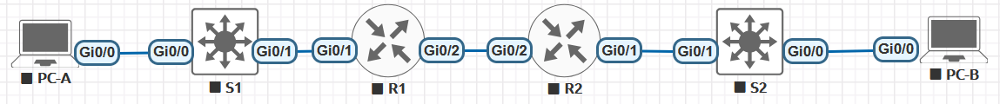

# Реализация DHCPv6.

###  Топология:


###  Таблица адресации:

| Устройство  | Интерфейс   | IPv6-адрес            | 
|-------------|-------------|-----------------------|
|     R1      |   G0/0      | 2001:db8:acad:2::1/64 |
|     R1      |   G0/0      | fe80::1               |
|     R1      |   G0/1      | 2001:db8:acad:1::1/64 |
|     R1      |   G0/1      | fe80::1               |
|     R2      |   G0/0      | 2001:db8:acad:2::2/64 |
|     R2      |   G0/0      | fe80::2               |
|     R2      |   G0/1      | 2001:db8:acad:3::1/64 | 
|     R2      |   G0/1      | fe80::1               |
|     PC-A    |   NIC       | DHCP                  | 
|     PC-B    |   NIC       | DHCP                  | 


###  Задание:

  [Часть 1. Создание сети и настройка основных параметров устройства;](#часть-1-создание-сети-и-настройка-основных-параметров-устройства)

  [Часть 2. Проверка назначения адреса SLAAC от R1;](#часть-2-проверка-назначения-адреса-slaac-от-r1)

  [Часть 3. Настройка и проверка сервера DHCPv6 на R1;](#часть-3-настройка-и-проверка-сервера-dhcpv6-на-r1)

  [Часть 4. Настройка сервера DHCPv6 с сохранением состояния на R1;](#часть-4-настройка-сервера-dhcpv6-с-сохранением-состояния-на-r1)

  [Часть 5. Настройка и проверка ретрансляции DHCPv6 на R2;](#часть-5-настройка-и-проверка-ретрансляции-dhcpv6-на-r2)  

###  Решение:
###  Часть 1. Создание сети и настройка основных параметров устройства

**Шаг 1.	Настройка базовых параметров маршрутизатора и коммутатора**

Команды даны для настройки S1 свича.

Для настройки R1,R2 и S2 используется:

hostname R1

hostname R2

hostname S2


```
conf t
no ip domain-lookup
hostname S1
service password-encryption
enable secret class
banner motd #
Unauthorized access is strictly prohibited. #

line console 0
password cisco
login

logging synchronous

line vty 0 4
password cisco
login
```

*Подробнее базовая настройка рассмотрена в LAB01.*


**Шаг 2. Настройка интерфейсов и маршрутизации для R1 и R2**

R1:

```
ipv6 unicast-routing

interface gigabitEthernet 0/0
ipv6 enable
ipv6 address 2001:db8:acad:2::1/64
ipv6 address fe80::1 link-local
no shut

interface gigabitEthernet 0/1
ipve enable
ipv6 address 2001:db8:acad:1::1/64
ipv6 address fe80::1 link-local
no shut

ipv6 route ::/0 2001:db8:acad:2::2
```

R2:

```
ipv6 unicast-routing

interface gigabitEthernet 0/0
ipv6 enable
ipv6 address 2001:db8:acad:2::2/64
ipv6 address fe80::2 link-local
no shut

interface gigabitEthernet 0/1
ipv6 enable
ipv6 address 2001:db8:acad:3::1/64
ipv6 address fe80::1 link-local
no shut

ipv6 route ::/0 2001:db8:acad:2::1

R2#ping 2001:db8:acad:2::1
Type escape sequence to abort.
Sending 5, 100-byte ICMP Echos to 2001:DB8:ACAD:2::1, timeout is 2 seconds:
!!!!!
Success rate is 100 percent (5/5), round-trip min/avg/max = 1/3/11 ms
R2#

```


### Часть 2. Проверка назначения адреса SLAAC от R1

PC-A (router):

```
interface g0/0
ipv6 enable
ipv6 address autoconfig default
no shutdown

PC-A#show ipv6 interface brief
GigabitEthernet0/0     [up/up]
    FE80::5200:FF:FE14:0
    2001:DB8:ACAD:1:5200:FF:FE14:0
```

Откуда взялась часть адреса с идентификатором хоста?
> Индентификатор хоста была сгенерирована случайным образом.


### Часть 3. Настройка и проверка сервера DHCPv6 на R1

**Шаг 1. Проверка отсуствия DNS и domain на PC-A**

```
PC-A#show ipv6 dhcp interface g0/0
PC-A#
```

**Шаг 2. Настройте R1 для предоставления DHCPv6 без состояния для PC-A.**

R1:
```
R1(config)# ipv6 unicast-routing
R1(config)# ipv6 dhcp pool R1-STATELESS
R1(config-dhcp)# dns-server 2001:db8:acad::254
R1(config-dhcp)# domain-name STATELESS.com

R1(config)# interface g0/1
R1(config-if)# ipv6 nd other-config-flag 
R1(config-if)# ipv6 dhcp server R1-STATELESS

```

PC-A:

```
PC-A#show ipv6 dhcp interface g0/0
GigabitEthernet0/0 is in client mode
  Prefix State is IDLE
  Address State is IDLE
  List of known servers:
    Reachable via address: FE80::1
    DUID: 00030001500000150000
    Preference: 0
    Configuration parameters:
      DNS server: 2001:DB8:ACAD::254
      Domain name: STATELESS.com
      Information refresh time: 0
  Prefix Rapid-Commit: disabled
  Address Rapid-Commit: disabled
PC-A#
```

###  Часть 4. Настройка сервера DHCPv6 с сохранением состояния на R1

```
# a.	Создайте пул DHCPv6 на R1 для сети 2001:db8:acad:3:aaa::/80
R1(config)# ipv6 dhcp pool R2-STATEFUL
R1(config-dhcp)# address prefix 2001:db8:acad:3:aaa::/80
R1(config-dhcp)# dns-server 2001:db8:acad::254
R1(config-dhcp)# domain-name STATEFUL.com

# b.	Назначьте только что созданный пул DHCPv6 интерфейсу g0/0 на R1
R1(config)# interface g0/0
R1(config-if)# ipv6 dhcp server R2-STATEFUL
```


###  Часть 5. Настройка и проверка ретрансляции DHCPv6 на R2.

**Шаг 1. Включите PC-B и проверьте адрес SLAAC, который он генерирует**

PC-B (router):

```
interface g0/0
ipv6 enable
ipv6 address autoconfig default
no shutdown

PC-B#show ipv6 interface brief
GigabitEthernet0/0     [up/up]
    FE80::5200:FF:FE17:0
    2001:DB8:ACAD:3:5200:FF:FE17:0

PC-B#show ipv6 dhcp interface g0/0
PC-B#
```


**Шаг 2. Настройте R2 в качестве агента DHCP-ретрансляции для локальной сети на G0/1**

```
R2 (config) # interface g0/1
R2(config-if)# ipv6 nd managed-config-flag
R2(config-if)# ipv6 dhcp relay destination 2001:db8:acad:2::1 g0/0
```

**Шаг 3. Попытка получить адрес IPv6 из DHCPv6 на PC-B.**

PC-B:

```
interface g0/0
no ipv6 address autoconfig default
ipv6 address dhcp
shutdown
no shutdown


PC-B#show ipv6 interface brief
GigabitEthernet0/0     [up/up]
    FE80::5200:FF:FE17:0
    2001:DB8:ACAD:3:AAA:ABEB:2A57:C291

PC-B#show ipv6 dhcp interface g0/0
GigabitEthernet0/0 is in client mode
  Prefix State is IDLE
  Address State is OPEN
  Renew for address will be sent in 11:59:54
  List of known servers:
    Reachable via address: FE80::1
    DUID: 00030001500000150000
    Preference: 0
    Configuration parameters:
      IA NA: IA ID 0x00020001, T1 43200, T2 69120
        Address: 2001:DB8:ACAD:3:AAA:ABEB:2A57:C291/128
                preferred lifetime 86400, valid lifetime 172800
                expires at Oct 31 2026 09:45 AM (172795 seconds)
      DNS server: 2001:DB8:ACAD::254
      Domain name: STATEFUL.com
      Information refresh time: 0
  Prefix Rapid-Commit: disabled
  Address Rapid-Commit: disabled
```