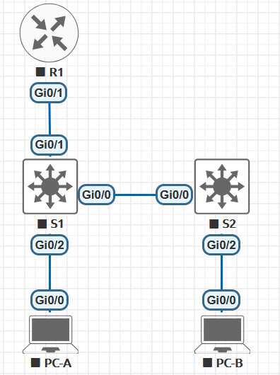

# Конфигурация безопасности коммутатора.

###  Топология:


###  Таблица адресации:

| Устройство  | Интерфейс/VLAN | IP-адрес       | Маска подсети    | 
|-------------|----------------|----------------|------------------|
|     R1      |   G0/1         | 192.168.10.1   |   255.255.255.0  |
|     R1      |   Loopback 0   | 10.10.1.1      |   255.255.255.0  |
|     S1      |   VLAN 10      | 192.168.10.201 |   255.255.255.0  |
|     S1      |   VLAN 10      | 192.168.10.202 |   255.255.255.0  |
|     PC A    |   NIC          | DHCP           |   255.255.255.0  |
|     PC B    |   NIC          | DHCP           |   255.255.255.0  |


###  Задание:

  [Часть 1. Настройка основного сетевого устройства;](#часть-1-настройка-основного-сетевого-устройства)

  [Часть 2. Настройка сетей VLAN на коммутаторах;](#часть-2-настройка-сетей-vlan-на-коммутаторах)

  [Часть 3. Настройки безопасности коммутатора;](#часть-3-настройки-безопасности-коммутатора)

  [Вопросы для повторения;](#вопросы-для-повторения)


###  Решение:
###  Часть 1. Настройка основного сетевого устройства
**Настройка маршрутизатора R1**

Загружаем следующий конфигурационный скрипт на R1

```
enable
configure terminal
hostname R1
no ip domain lookup
ip dhcp excluded-address 192.168.10.1 192.168.10.9
ip dhcp excluded-address 192.168.10.201 192.168.10.202
ip dhcp relay information trust-all
!
ip dhcp pool Students
 network 192.168.10.0 255.255.255.0
 default-router 192.168.10.1
 domain-name CCNA2.Lab-11.6.1
!
interface Loopback0
 ip address 10.10.1.1 255.255.255.0
!
interface GigabitEthernet0/1
 description Link to S1
 ip address 192.168.10.1 255.255.255.0
 no shutdown
!
line con 0
 logging synchronous
 exec-timeout 0 0

```

Проверка:

```
R1#show ip interface brief
Interface                  IP-Address      OK? Method Status                Protocol
GigabitEthernet0/0         192.168.10.1    YES manual up                    up
GigabitEthernet0/1         unassigned      YES unset  administratively down down
Loopback0                  10.10.1.1       YES manual up                    up
R1#
```

**Настройка коммутаторов S1 и S2**

Команды даны для настройки S1 свича.

Для настройки S2 используется:

hostname S2


```
conf t
no ip domain-lookup
hostname S1
service password-encryption
enable secret class
banner motd #
Unauthorized access is strictly prohibited. #

line console 0
password cisco
login

logging synchronous

line vty 0 4
password cisco
login
```

*Подробнее базовая настройка рассмотрена в LAB01.*

Шлюз по умолчанию для VLAN управления значение 192.168.10.1.

S1/S2:
```
ip default-gateway 192.168.10.1
```


### Часть 2. Настройка сетей VLAN на коммутаторах

На всех коммутаторах необходимо выполнить:

```
# Шаг 1:	Сконфигруриуйте VLAN 10.
vlan 10
name Management


# Шаг 2:	Сконфигруриуйте SVI для VLAN 10.
# S1:
interface vlan 10
ip address 192.168.10.201 255.255.255.0
description Management
no shut

# S2:
interface vlan 10
ip address 192.168.10.202 255.255.255.0
description Management
no shut


# Шаг 3:	Настройка vlan 333 с именем Native и vlan 999 с именем ParkingLot на S1 и S2.
vlan 333
name Native

vlan 999
name ParkingLot
```

### Часть 3. Настройки безопасности коммутатора

**Шаг 1:	Релизация магистральных соединений 802.1Q**

S1,S2:
```
interface gi0/0
switchport trunk encapsulation dot1q
switchport mode trunk
switchport trunk native vlan 333
```

Убедитесь, что режим транкинга успешно настроен на всех коммутаторах.

```
S1#show interface trunk

Port        Mode             Encapsulation  Status        Native vlan
Gi0/0       on               802.1q         trunking      333

Port        Vlans allowed on trunk
Gi0/0       1-4094

Port        Vlans allowed and active in management domain
Gi0/0       1,10,333,999

Port        Vlans in spanning tree forwarding state and not pruned
Gi0/0       none
```


Отключить согласование DTP gi0/0 на S1 и S2. 

S1,S2:
```
interface gi 0/0
switchport nonegotiate

S1#show interfaces gi0/0 switchport | include Negotiation
Negotiation of Trunking: Off
```

**Шаг 2. Настройка портов доступа**

a.	На S1 настройте gi0/1 и gi0/2 в качестве портов доступа и свяжите их с VLAN 10.
b.	На S2 настройте порт доступа gi0/2 и свяжите его с VLAN 10.

S1:

```
interface range gi0/1-2
switchport mode access
switchport access vlan 10
```

S2:

```
interface gi0/2
switchport mode access
switchport access vlan 10

```

**Шаг 3. Безопасность неиспользуемых портов коммутатора**

На S1 и S2 переместите неиспользуемые порты из VLAN 1 в VLAN 999 и отключите неиспользуемые порты.

S1:

```
interface gi0/3
switchport mode access
switchport access vlan 999
shutdown
```

S2:

```
interface range gi0/1,gi0/3
switchport mode access
switchport access vlan 999
shutdown
```

Убедитесь, что неиспользуемые порты отключены и связаны с VLAN 999

```
S1#show interfaces status

Port      Name               Status       Vlan       Duplex  Speed Type
Gi0/0                        connected    trunk        auto   auto unknown
Gi0/1                        connected    10           auto   auto unknown
Gi0/2                        connected    10           auto   auto unknown
Gi0/3                        disabled     999          auto   auto unknown

S2#show interfaces status

Port      Name               Status       Vlan       Duplex  Speed Type
Gi0/0                        connected    trunk        auto   auto unknown
Gi0/1                        disabled     999          auto   auto unknown
Gi0/2                        connected    10           auto   auto unknown
Gi0/3                        disabled     999          auto   auto unknown

```

**Шаг 4. Документирование и реализация функций безопасности порта.**

Безопасность портов доступа.

**Конфигурация безопасности порта по умолчанию.**

```
S1#show port-security interface gi0/2
Port Security              : Disabled - Защита портов
Port Status                : Secure-down
Violation Mode             : Shutdown - Режим проверки на нарушение безопасности
Aging Time                 : 0 mins   - Aging Time
Aging Type                 : Absolute - Aging Type
SecureStatic Address Aging : Disabled - Secure Static Address Aging
Maximum MAC Addresses      : 1        - Максимальное количество записей MAC-адресов
Total MAC Addresses        : 0
Configured MAC Addresses   : 0
Sticky MAC Addresses       : 0        - Sticky MAC Address
Last Source Address:Vlan   : 0000.0000.0000:0
Security Violation Count   : 0
```

b.	На S1 включите защиту порта на gi0/2 со следующими настройками: 
o	Максимальное количество записей MAC-адресов: 3
o	Режим безопасности: restrict
o	Aging time: 60 мин.
o	Aging type: неактивный

S1:

```
interface gi0/2
switchport port-security
switchport port-security maximum 3
switchport port-security mac-address sticky
switchport port-security violation restrict
switchport port-security aging time 60
```

Check:

```
S1#show port-security interface gi0/2
Port Security              : Enabled
Port Status                : Secure-up
Violation Mode             : Restrict
Aging Time                 : 60 mins
Aging Type                 : Absolute
SecureStatic Address Aging : Disabled
Maximum MAC Addresses      : 3
Total MAC Addresses        : 1
Configured MAC Addresses   : 0
Sticky MAC Addresses       : 1
Last Source Address:Vlan   : 5000.0004.0000:10
Security Violation Count   : 0
```

```
S1#show port-security address
               Secure Mac Address Table
-----------------------------------------------------------------------------
Vlan    Mac Address       Type                          Ports   Remaining Age
                                                                   (mins)
----    -----------       ----                          -----   -------------
  10    5000.0004.0000    SecureSticky                  Gi0/2        -
-----------------------------------------------------------------------------
Total Addresses in System (excluding one mac per port)     : 0
Max Addresses limit in System (excluding one mac per port) : 4096
```

e.	Настройте следующие параметры безопасности порта на S2 gi0/2:
o	Максимальное количество записей MAC-адресов: 2
o	Тип безопасности: Protect
o	Aging time: 60 мин.

S2:

```
interface gi0/2
switchport port-security
switchport port-security maximum 2
switchport port-security mac-address sticky
switchport port-security violation protect
switchport port-security aging time 60
```

Check:

```
S2#show port-security interface gi0/2
Port Security              : Enabled
Port Status                : Secure-up
Violation Mode             : Protect
Aging Time                 : 60 mins
Aging Type                 : Absolute
SecureStatic Address Aging : Disabled
Maximum MAC Addresses      : 2
Total MAC Addresses        : 1
Configured MAC Addresses   : 0
Sticky MAC Addresses       : 1
Last Source Address:Vlan   : 5000.0005.0000:10
Security Violation Count   : 0


S2#show port-security address
               Secure Mac Address Table
-----------------------------------------------------------------------------
Vlan    Mac Address       Type                          Ports   Remaining Age
                                                                   (mins)
----    -----------       ----                          -----   -------------
  10    5000.0005.0000    SecureSticky                  Gi0/2        -
-----------------------------------------------------------------------------
Total Addresses in System (excluding one mac per port)     : 0
Max Addresses limit in System (excluding one mac per port) : 4096
```

**Шаг 5. Реализовать безопасность DHCP snooping.**

a.	На S2 включите DHCP snooping и настройте DHCP snooping во VLAN 10.

b.	Настройте магистральные порты на S2 как доверенные порты.

c.	Ограничьте ненадежный порт Fa0/18 на S2 пятью DHCP-пакетами в секунду.

S2:

```
ip dhcp snooping
ip dhcp snooping vlan 10

interface gi0/0
ip dhcp snooping trust

interface gi0/2
ip dhcp snooping limit rate 5

S2(config-if)#do show ip dhcp snooping
Switch DHCP snooping is enabled
Switch DHCP gleaning is disabled
DHCP snooping is configured on following VLANs:
10
DHCP snooping is operational on following VLANs:
10
DHCP snooping is configured on the following L3 Interfaces:

Insertion of option 82 is enabled
   circuit-id default format: vlan-mod-port
   remote-id: 5000.0003.0000 (MAC)
Option 82 on untrusted port is not allowed
Verification of hwaddr field is enabled
Verification of giaddr field is enabled
DHCP snooping trust/rate is configured on the following Interfaces:

Interface                  Trusted    Allow option    Rate limit (pps)
-----------------------    -------    ------------    ----------------
GigabitEthernet0/0         yes        yes             unlimited
  Custom circuit-ids:
GigabitEthernet0/2         no         no              5
  Custom circuit-ids:

```

e.	В командной строке на PC-B освободите, а затем обновите IP-адрес.

PC-B:

```
interface g0/0
ip address dhcp
no shut

PC-B#show ip interface brief
Interface                  IP-Address      OK? Method Status                Protocol
GigabitEthernet0/0         192.168.10.13   YES DHCP   up                    up
PC-B#
```

e.	В командной строке на PC-B освободите, а затем обновите IP-адрес.

```
PC-B#release dhcp gigabitEthernet 0/0
PC-B#
PC-B#renew dhcp gigabitEthernet 0/0
Not in Bound state.
PC-B#show ip interface brief
Interface                  IP-Address      OK? Method Status                Protocol
GigabitEthernet0/0         192.168.10.14   YES DHCP   up                    up
PC-B#
*Oct 30 08:20:39.975: %DHCP-6-ADDRESS_ASSIGN: Interface GigabitEthernet0/0 assigned DHCP address 192.168.10.14, mask 255.255.255.0, hostname PC-B
```

f.	Проверьте привязку отслеживания DHCP

```
S2#show ip dhcp snooping binding
MacAddress          IpAddress        Lease(sec)  Type           VLAN  Interface
------------------  ---------------  ----------  -------------  ----  --------------------
50:00:00:07:00:00   192.168.10.14    86243       dhcp-snooping   10    GigabitEthernet0/2
Total number of bindings: 1
```


**Шаг 6. Реализация PortFast и BPDU Guard**

a.	Настройте PortFast на всех портах доступа, которые используются на обоих коммутаторах.

b.	Включите защиту BPDU на портах доступа VLAN 10 S1 и S2, подключенных к PC-A и PC-B.

c.	Убедитесь, что защита BPDU и PortFast включены на соответствующих портах.


```
S1:
interface gi0/1
spanning-tree portfast

interface gi0/2
spanning-tree portfast
spanning-tree bpduguard enable


S2:
interface gi0/2
spanning-tree portfast
spanning-tree bpduguard enable


S1# show spanning-tree interface gi0/2 detail
 Port 3 (GigabitEthernet0/2) of VLAN0010 is designated forwarding
   Port path cost 4, Port priority 128, Port Identifier 128.3.
   Designated root has priority 32778, address 5000.001e.0000
   Designated bridge has priority 32778, address 5000.001e.0000
   Designated port id is 128.3, designated path cost 0
   Timers: message age 0, forward delay 0, hold 0
   Number of transitions to forwarding state: 1
   The port is in the portfast edge mode
   Link type is point-to-point by default
   Bpdu guard is enabled
   BPDU: sent 1472, received 0

```

**Шаг 7. Проверьте наличие сквозного подключения.**

PC-B:

```
PC-B#ping 192.168.10.1
Type escape sequence to abort.
Sending 5, 100-byte ICMP Echos to 192.168.10.1, timeout is 2 seconds:
!!!!!
Success rate is 100 percent (5/5), round-trip min/avg/max = 6/6/8 ms
PC-B#

```

### Ответы на вопросы

1.	С точки зрения безопасности порта на S2, почему нет значения таймера для оставшегося возраста в минутах, когда было сконфигурировано динамическое обучение - sticky?

> режим sticky обеспечивает постоянное сохранение в конфиг, для них нет remaning age

2.	Что касается безопасности порта на S2, если вы загружаете скрипт текущей конфигурации на S2, почему порту gi0/2 на PC-B никогда не получит IP-адрес через DHCP?

> потому что включен режим sticky, из-за которого mac-add был записан в конфиг

3.	Что касается безопасности порта, в чем разница между типом абсолютного устаревания и типом устаревание по неактивности?
> switchport port-security aging {static | time time | type {absolute | inactivity} }
> абсолютное устаревание (absolute) - защищенные адреса порта удаляются по истечению указанного времени
> устаревание по неактивности (inactivity) - безопасные адреса на порту удаляются, только если они неактивны в течение указанного времени 
