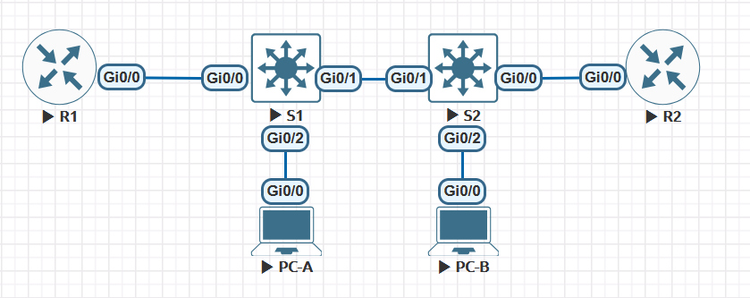

# Настройка и проверка расширенных списков контроля доступа.

###  Топология:


###  Таблица адресации:

| Устройство  | Интерфейс/VLAN | IP-адрес    | Маска подсети    | Шлюз по умолчанию |
|-------------|----------------|-------------|------------------|-------------------|
|     R1      |   G0/0         |     -       |        -         |       -           |
|     R1      |   G0/0.20      | 10.20.0.1   |   255.255.255.0  |     ---           |
|     R1      |   G0/0.30      | 10.30.0.1   |   255.255.255.0  |     ---           |
|     R1      |   G0/0.40      | 10.40.0.1   |   255.255.255.0  |     ---           |
|     R1      |   G0/0.1000    |     -       |        -         |     ---           |
|     R1      |   Loopback 0   | 172.16.1.1  |   255.255.255.0  |     ---           |
|     R2      |   G0/0         | 10.20.0.4   |   255.255.255.0  |     ---           |
|     S1      |   VLAN 20      | 10.20.0.2   |   255.255.255.0  |     10.20.0.1     |
|     S2      |   VLAN 20      | 10.20.0.3   |   255.255.255.0  |     10.20.0.1     |
|     PC-A    |   NIC          | 10.30.0.10  |   255.255.255.0  |     10.30.0.1     |
|     PC-B    |   NIC          | 10.40.0.10  |   255.255.255.0  |     10.40.0.1     |


###  Таблица VLAN:

| VLAN  |        Имя     | Назначенный интерфейс                 |
|-------|----------------|---------------------------------------|
|  20   |   Management   | S2: Gi0/0                             |
|  30   |   Operations   | S1: Gi0/2                             |
|  40   |   Sales        | S2: Gi0/2                             |
|  999  |   ParkingLot   | S1: Gi0/3, S2: Gi0/3                  |
|  1000 |   NativeVLAN   | -                                     |


###  Задание:

  [Часть 1. Создание сети и настройка основных параметров устройства;](#часть-1-создание-сети-и-настройка-основных-параметров-устройства)

  [Часть 2. Настройка сетей VLAN на коммутаторах;](#часть-2-настройка-сетей-vlan-на-коммутаторах)

  [Часть 3. Настройка транков (магистральные каналы);](#часть-3-настройка-транков-магистральные-каналы)

  [Часть 4. Настройте маршрутизацию;](#часть-4-настройте-маршрутизацию)

  [Часть 5. Настройте удаленный доступ;](#часть-5-настройте-удаленный-доступ)

  [Часть 6. Проверка подключения;](#часть-6-проверка-подключения)

  [Часть 7. Настройка и проверка списков контроля доступа (ACL);](#часть-7-настройка-и-проверка-списков-контроля-доступа-acl)


###  Решение:
###  Часть 1. Создание сети и настройка основных параметров устройства

**Шаг 1.	Настройка базовых параметров маршрутизатора и коммутатора**

Команды даны для настройки S1 свича.

```
conf t
no ip domain-lookup
hostname S1
service password-encryption
enable secret class
banner motd #
Unauthorized access is strictly prohibited. #

line console 0
password cisco
login

logging synchronous

line vty 0 4
password cisco
login
```

*Подробнее базовая настройка рассмотрена в LAB01.*


### Часть 2. Настройка сетей VLAN на коммутаторах

**Шаг 1. Настройте адреса интерфейса и базового OSPFv2 на каждом маршрутизаторе.**

**Шаг 1. Настройка VLAN на свичах.**

S1/S2:

```
vlan 20
name Management

vlan 30
name Operations

vlan 40
name Sales

vlan 999
name ParkingLot

vlan 1000
name NativeVLAN
```

**Шаг 2. Настройка интерфейса управления и шлюз по умолчанию.**

S1:

```
interface vlan 20
ip address 10.20.0.2 255.255.255.0
no shut
exit
ip default-gateway 10.20.0.1
```

S2:

```
interface vlan 20
ip address 10.20.0.3 255.255.255.0
no shut
exit
ip default-gateway 10.20.0.1
```

**Шаг 3. Перевод неиспользуемых портов в VLAN 999 и их деактивация.**

S1/S2:

```
interface gi0/3
switchport mode access
switchport access vlan 999
shutdown
exit
```


**Шаг 4. Назначьте сети VLAN соответствующим интерфейсам коммутатора.**

S1:

```
int gi0/2
switchport mode access
switchport access vlan 30
no shut

S1#show vlan brief

VLAN Name                             Status    Ports
---- -------------------------------- --------- -------------------------------
1    default                          active    Gi0/0, Gi0/1
20   Management                       active
30   Operations                       active    Gi0/2
40   Sales                            active
999  ParkingLot                       active    Gi0/3
1000 NativeVLAN                       active

```


S2:

```
int gi0/0
switchport mode access
switchport access vlan 20
no shut

int gi0/2
switchport mode access
switchport access vlan 40
no shut

S2#show vlan brief

VLAN Name                             Status    Ports
---- -------------------------------- --------- -------------------------------
1    default                          active    Gi0/1
20   Management                       active    Gi0/0
30   Operations                       active
40   Sales                            active    Gi0/2
999  ParkingLot                       active    Gi0/3
1000 NativeVLAN                       active
```


###  Часть 3. Настройка транков (магистральные каналы)

**Настройка магистрального интерфейса Gi0/1 на S1 и S2**


```
int Gi0/1
switchport trunk encapsulation dot1q
switch mode trunk
switch trunk allowed vlan 20,30,40,1000
switch trunk native vlan 1000
switchport nonegotiate
```

**Настройка интерфейса Gi0/0 на S1**

```
int Gi0/0
switchport trunk encapsulation dot1q
switch mode trunk
switch trunk allowed vlan 20,30,40,1000
switch trunk native vlan 1000
switchport nonegotiate
```

```
S1#show int trunk

Port        Mode             Encapsulation  Status        Native vlan
Gi0/0       on               802.1q         trunking      1000
Gi0/1       on               802.1q         trunking      1000

Port        Vlans allowed on trunk
Gi0/0       10,20,30,1000
Gi0/1       20,30,40,1000

Port        Vlans allowed and active in management domain
Gi0/0       20,30,1000
Gi0/1       20,30,40,1000

Port        Vlans in spanning tree forwarding state and not pruned
Gi0/0       none
Gi0/1       20,30,40
S1#


S2#show int trunk

Port        Mode             Encapsulation  Status        Native vlan
Gi0/1       on               802.1q         trunking      1000

Port        Vlans allowed on trunk
Gi0/1       20,30,40,1000

Port        Vlans allowed and active in management domain
Gi0/1       20,30,40,1000

Port        Vlans in spanning tree forwarding state and not pruned
Gi0/1       20,30,40,1000
S2#
```

###  Часть 4. Настройте маршрутизацию

R1:

```
int G0/0.20
encapsulation dot1q 20
ip add 10.20.0.1 255.255.255.0

int G0/0.30
encapsulation dot1q 30
ip add 10.30.0.1 255.255.255.0

int G0/0.40
encapsulation dot1q 40
ip add 10.40.0.1 255.255.255.0

int G0/0.1000
encapsulation dot1q 1000 native

int G0/0
no shut

int lo0
ip add 172.16.1.1 255.255.255.0
no shut

R1#show ip interface brief
Interface                  IP-Address      OK? Method Status                Protocol
GigabitEthernet0/0         unassigned      YES unset  up                    up
GigabitEthernet0/0.20      10.20.0.1       YES manual up                    up
GigabitEthernet0/0.30      10.30.0.1       YES manual up                    up
GigabitEthernet0/0.40      10.40.0.1       YES manual up                    up
Loopback0                  172.16.1.1      YES manual up                    up
```

R2:

```
int G0/0
ip add 10.20.0.4 255.255.255.0
no shut
ip route 0.0.0.0 0.0.0.0 10.20.0.1
```

###  Часть 5. Настройте удаленный доступ

**Шаг 1. Настройте аутентификацию устройств.**

Настройка всех сетевых устройств:

```
ip domain-name ccna-lab.com 
```

**Шаг 2. Создайте ключ шифрования с указанием его длины.**

```
crypto key generate rsa 
1024
```
**Шаг 3. Создайте имя пользователя в локальной базе учетных записей.**

```
ip ssh version 2
username SSHadmin privilege 15 secret $cisco123!
```

**Шаг 4. Активируйте протокол SSH на линиях VTY.**

```
line vty 0 4
login local
transport input ssh 
```

**Шаг 5. Включите защищенные веб-службы с проверкой подлинности на R1.**

```
a.	Включите сервер HTTPS на R1.
R1(config)# ip http secure-server 

b.	Настройте R1 для проверки подлинности пользователей, пытающихся подключиться к веб-серверу.
R1(config)# ip http authentication local
```

###  Часть 6. Проверка подключения

Настройка PCs (routers):

```
PC-A:
hostname PC-A
int gi0/0
ip add 10.30.0.10 255.255.255.0
no shut
ip route 0.0.0.0 0.0.0.0 10.30.0.1

PC-B:
hostname PC-B
int gi0/0
ip add 10.40.0.10 255.255.255.0
no shut
ip route 0.0.0.0 0.0.0.0 10.40.0.1
```

PC-A:

```
PC-A#ping 10.40.0.10
Type escape sequence to abort.
Sending 5, 100-byte ICMP Echos to 10.40.0.10, timeout is 2 seconds:
!!!!!
Success rate is 100 percent (5/5), round-trip min/avg/max = 8/8/9 ms
PC-A#ping 10.20.0.1
Type escape sequence to abort.
Sending 5, 100-byte ICMP Echos to 10.20.0.1, timeout is 2 seconds:
!!!!!
Success rate is 100 percent (5/5), round-trip min/avg/max = 4/4/5 ms
PC-A#


PC-B:

PC-B#ping 10.30.0.10
Type escape sequence to abort.
Sending 5, 100-byte ICMP Echos to 10.30.0.10, timeout is 2 seconds:
!!!!!
Success rate is 100 percent (5/5), round-trip min/avg/max = 8/8/9 ms
PC-B#ping 10.20.0.1
Type escape sequence to abort.
Sending 5, 100-byte ICMP Echos to 10.20.0.1, timeout is 2 seconds:
!!!!!
Success rate is 100 percent (5/5), round-trip min/avg/max = 6/6/7 ms
PC-B#ping 172.16.1.1
Type escape sequence to abort.
Sending 5, 100-byte ICMP Echos to 172.16.1.1, timeout is 2 seconds:
!!!!!
Success rate is 100 percent (5/5), round-trip min/avg/max = 6/6/7 ms
PC-B#
```

```
R1#telnet 10.20.0.1 443
Trying 10.20.0.1, 443 ... Open

R1#telnet 172.16.1.1 443
Trying 172.16.1.1, 443 ... Open
```

```
PC-B#ssh -l SSHadmin 10.20.0.1

**************************************************************************
* IOSv is strictly limited to use for evaluation, demonstration and IOS  *
* education. IOSv is provided as-is and is not supported by Cisco's      *
* Technical Advisory Center. Any use or disclosure, in whole or in part, *
* of the IOSv Software or Documentation to any third party for any       *
* purposes is expressly prohibited except as otherwise authorized by     *
* Cisco in writing.                                                      *
**************************************************************************
Password:

Unauthorized access is strictly prohibited.
**************************************************************************
* IOSv is strictly limited to use for evaluation, demonstration and IOS  *
* education. IOSv is provided as-is and is not supported by Cisco's      *
* Technical Advisory Center. Any use or disclosure, in whole or in part, *
* of the IOSv Software or Documentation to any third party for any       *
* purposes is expressly prohibited except as otherwise authorized by     *
* Cisco in writing.                                                      *
**************************************************************************
R1#

PC-B#ssh -l SSHadmin 172.16.1.1

**************************************************************************
* IOSv is strictly limited to use for evaluation, demonstration and IOS  *
* education. IOSv is provided as-is and is not supported by Cisco's      *
* Technical Advisory Center. Any use or disclosure, in whole or in part, *
* of the IOSv Software or Documentation to any third party for any       *
* purposes is expressly prohibited except as otherwise authorized by     *
* Cisco in writing.                                                      *
**************************************************************************
Password:

Unauthorized access is strictly prohibited.
**************************************************************************
* IOSv is strictly limited to use for evaluation, demonstration and IOS  *
* education. IOSv is provided as-is and is not supported by Cisco's      *
* Technical Advisory Center. Any use or disclosure, in whole or in part, *
* of the IOSv Software or Documentation to any third party for any       *
* purposes is expressly prohibited except as otherwise authorized by     *
* Cisco in writing.                                                      *
**************************************************************************
R1#
```

###  Часть 7. Настройка и проверка списков контроля доступа (ACL)

При проверке базового подключения компания требует реализации следующих политик безопасности:

Политика 1. Сеть Sales не может использовать SSH в сети Management (но в  другие сети SSH разрешен).

Политика 2. Сеть Sales не имеет доступа к IP-адресам в сети Management с помощью любого веб-протокола (HTTP/HTTPS). Сеть Sales также не имеет доступа к интерфейсам R1 с помощью любого веб-протокола. Разрешён весь другой веб-трафик (обратите внимание — Сеть Sales  может получить доступ к интерфейсу Loopback 1 на R1).

Политика 3. Сеть Sales не может отправлять эхо-запросы ICMP в сети Operations или Management. Разрешены эхо-запросы ICMP к другим адресатам. 

Политика 4: Cеть Operations  не может отправлять ICMP эхозапросы в сеть Sales. Разрешены эхо-запросы ICMP к другим адресатам. 

R1:

```
ip access-list extended ACL_for_SALES
 remark Policy 1. sales can't use ssh for mgmt
 deny tcp 10.40.0.0 0.0.0.255 10.20.0.0 0.0.0.255 eq 22

 remark Policy 2. sales can't use http/https for mgmt and int on R1
 deny tcp 10.40.0.0 0.0.0.255 10.20.0.0 0.0.0.255 eq 80
 deny tcp 10.40.0.0 0.0.0.255 10.20.0.0 0.0.0.255 eq 443
 deny tcp 10.40.0.0 0.0.0.255 host 10.30.0.1 eq 80
 deny tcp 10.40.0.0 0.0.0.255 host 10.30.0.1 eq 443
 deny tcp 10.40.0.0 0.0.0.255 host 10.40.0.1 eq 80
 deny tcp 10.40.0.0 0.0.0.255 host 10.40.0.1 eq 443

 remark Policy 3. sales can't ping mgmt and operations
  deny icmp 10.40.0.0 0.0.0.255 10.20.0.0 0.0.0.255 echo
  deny icmp 10.40.0.0 0.0.0.255 10.30.0.0 0.0.0.255 echo

 permit ip any any


ip access-list extended ACL_for_OPERATIONS
 remark Policy 3. operations can't ping sales  
  deny icmp 10.30.0.0 0.0.0.255 10.40.0.0 0.0.0.255 echo

 permit ip any any

interface GigabitEthernet0/0.40
 ip access-group ACL_for_SALES in

interface GigabitEthernet0/0.30
 ip access-group ACL_for_OPERATIONS in
```

** Команды для проверки**

```
PC-A#ping 10.40.0.10
Type escape sequence to abort.
Sending 5, 100-byte ICMP Echos to 10.40.0.10, timeout is 2 seconds:
U.U.U
Success rate is 0 percent (0/5)

PC-A#ping 10.20.0.1
Type escape sequence to abort.
Sending 5, 100-byte ICMP Echos to 10.20.0.1, timeout is 2 seconds:
!!!!!


PC-B#ping 10.30.0.10
Type escape sequence to abort.
Sending 5, 100-byte ICMP Echos to 10.30.0.10, timeout is 2 seconds:
U.U.U
Success rate is 0 percent (0/5)


PC-B#ping 10.20.0.1
Type escape sequence to abort.
Sending 5, 100-byte ICMP Echos to 10.20.0.1, timeout is 2 seconds:
U.U.U
Success rate is 0 percent (0/5)


PC-B#ping 172.16.1.1
Type escape sequence to abort.
Sending 5, 100-byte ICMP Echos to 172.16.1.1, timeout is 2 seconds:
!!!!!
Success rate is 100 percent (5/5), round-trip min/avg/max = 6/6/7 ms


PC-B#telnet 10.20.0.1 443
Trying 10.20.0.1, 443 ...
% Destination unreachable; gateway or host down


PC-B#telnet 172.16.1.1 443
Trying 172.16.1.1, 443 ... Open


PC-B#ssh -l SSHadmin 10.20.0.4
% Destination unreachable; gateway or host down


PC-B#ssh -l SSHadmin 172.16.1.1

**************************************************************************
* IOSv is strictly limited to use for evaluation, demonstration and IOS  *
* education. IOSv is provided as-is and is not supported by Cisco's      *
* Technical Advisory Center. Any use or disclosure, in whole or in part, *
* of the IOSv Software or Documentation to any third party for any       *
* purposes is expressly prohibited except as otherwise authorized by     *
* Cisco in writing.                                                      *
**************************************************************************
Password:
```

```
R1#show access-lists
Extended IP access list ACL_for_OPERATIONS
    10 deny icmp 10.30.0.0 0.0.0.255 10.40.0.0 0.0.0.255 echo (10 matches)
    20 permit ip any any (5 matches)
Extended IP access list ACL_for_SALES
    10 deny tcp 10.40.0.0 0.0.0.255 10.20.0.0 0.0.0.255 eq 22 (2 matches)
    20 deny tcp 10.40.0.0 0.0.0.255 10.20.0.0 0.0.0.255 eq www
    30 deny tcp 10.40.0.0 0.0.0.255 10.20.0.0 0.0.0.255 eq 443 (1 match)
    40 deny tcp 10.40.0.0 0.0.0.255 host 10.30.0.1 eq www
    50 deny tcp 10.40.0.0 0.0.0.255 host 10.30.0.1 eq 443
    60 deny tcp 10.40.0.0 0.0.0.255 host 10.40.0.1 eq www
    70 deny tcp 10.40.0.0 0.0.0.255 host 10.40.0.1 eq 443
    80 deny icmp 10.40.0.0 0.0.0.255 10.20.0.0 0.0.0.255 echo (5 matches)
    90 deny icmp 10.40.0.0 0.0.0.255 10.30.0.0 0.0.0.255 echo (5 matches)
    100 permit ip any any (93 matches)

R1#show ip interface GigabitEthernet0/0.40 | include access list
  Outgoing access list is not set
  Inbound  access list is ACL_for_SALES
R1#

R1#show ip interface GigabitEthernet0/0.30 | include access list
  Outgoing access list is not set
  Inbound  access list is ACL_for_OPERATIONS
R1#
```